# halloween

A temporary Halloween mod for the minetest servers.

The mod changes **only the look** of existing nodes, items, mobs and the unified_inventory window. It registers
no items, crafts or entities and writes nothing into node metadata, inventories or mob staticdata. The only
registered node is a helper for the protected chest (the skull with an open mouth), and it is never left in the
map (see [How it works](#how-it-works)). After the event the mod folder can simply be deleted and everything
goes back to normal.

## What changes

| What             | Halloween look                                  | Nodes / items                                            |
|------------------|-------------------------------------------------|----------------------------------------------------------|
| Apples           | apple wrapped in cobweb                         | `default:apple`                                          |
| Torches          | glowing skull (floor, wall and ceiling)         | `default:torch`, `default:torch_wall`, `default:torch_ceiling` |
| Locked chests    | small coffin                                    | `default:chest_locked*` (including big chests from `connected_chests`) |
| Unlocked chests  | glowing jack-o'-lantern                         | `default:chest*` (including big chests from `connected_chests`) |
| Protected chests | skull that opens its mouth while someone looks inside | `protector:chest` |
| Locked doors     | jack-o'-lantern painted on the door             | doors and trapdoors registered with `protected = true` (`doors:door_steel`, `doors:trapdoor_steel`, `xpanes:door_steel_bar`, `xpanes:trapdoor_steel_bar`) |
| Protected doors  | spiders sitting on black cobwebs                | `protector:door_wood`, `protector:door_steel`, `protector:trapdoor`, `protector:trapdoor_steel` |
| Armor and shields| skeleton bones painted on top                   | every tool with an `armor_head/torso/legs/feet/shield` group (3d_armor, shields, etc.) |
| Sheep            | skeleton with a pumpkin head                    | all `mobs_animal:sheep_*` entities                       |
| Inventory window | cobwebs, cracks and spiders on the background, pumpkins, skulls, bones and coffins along the bottom | `unified_inventory` (only if the mod is on the server) |

Node behaviour (hardness, drops, formspecs, chest and door protection) stays the same. Only `tiles`,
`mesh`, `node_box`, `selection_box` and `inventory_image`/`wield_image` change, plus `texture`/`preview`
for armor. The protected chest additionally gets `paramtype = "light"` (needed to light a mesh) and a
wrapped `on_rightclick` that opens the mouth.

## Screenshots

**Unlocked chests:** jack-o'-lanterns (single, open, big chest from `connected_chests`).

**Locked chests:** coffins (closed, open, big locked chest).

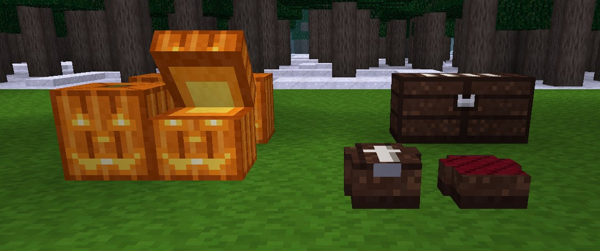

**Protected chests:** skulls; the one in the middle is open (somebody is looking inside), the mouth shows
the treasure. The right one is turned sideways.

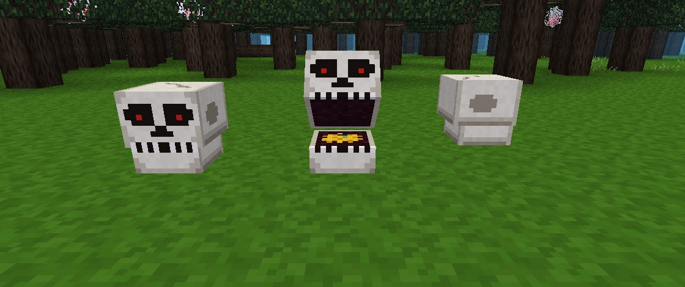

**Doors:** protected wooden and steel doors with spiders on black cobwebs, the locked steel door and the
steel bar door with a jack-o'-lantern, then open trapdoors in the same order. The hotbar shows the items:
a skull for the protected chest, a spider badge on protected doors and a pumpkin badge on locked ones.

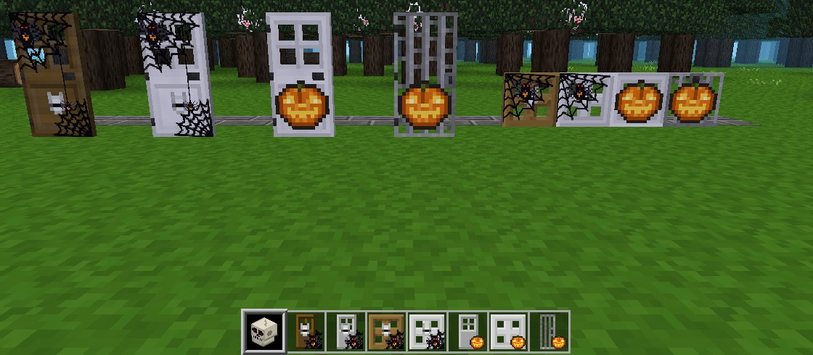

**Torches:** glowing skulls on the floor, on a wall and under a ceiling (at night).

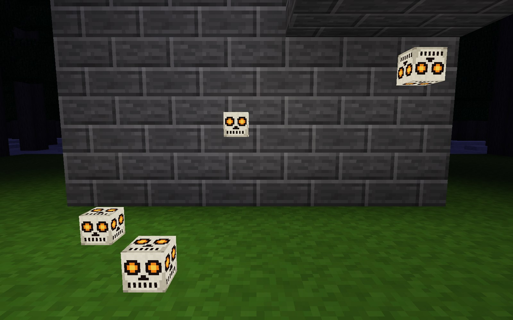

**Apples:** wrapped in cobweb.

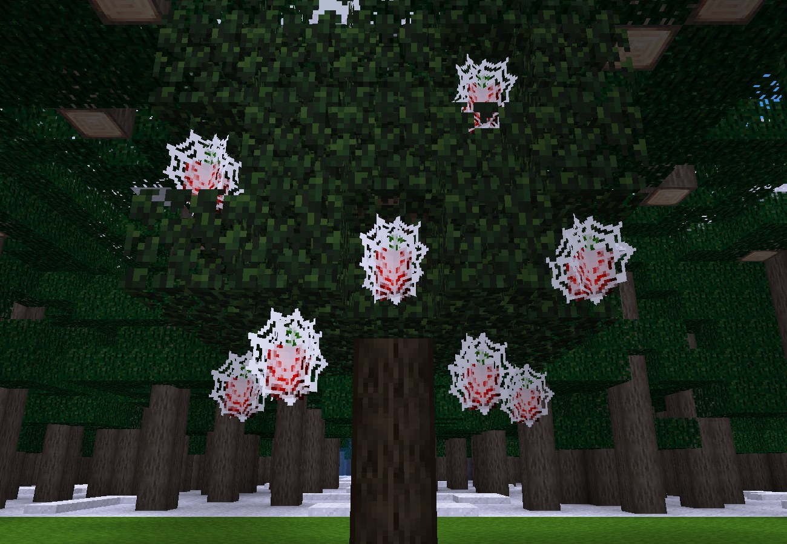

**Armor:** bones painted on top of steel, gold and diamond armor (on armor stands).

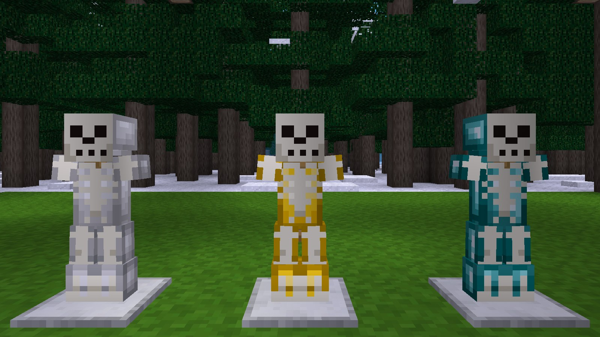

**Sheep:** skeletons with a pumpkin head.

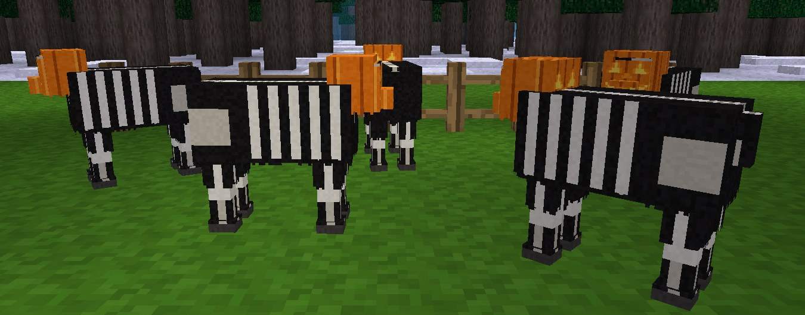

**Items in the hotbar and in hand:** apple, skull, pumpkin, coffin and armor with a skull badge.

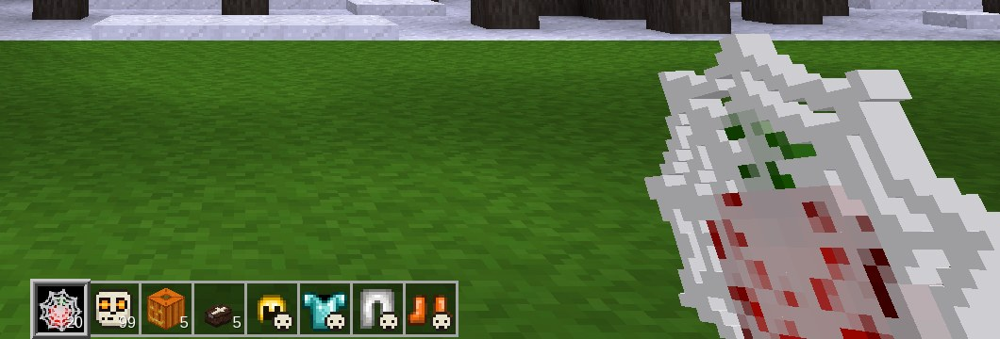

**unified_inventory:** crafting page, crafting guide, armor page (3d_armor_ui), bags page
and the lite layout (`unified_inventory_lite`).

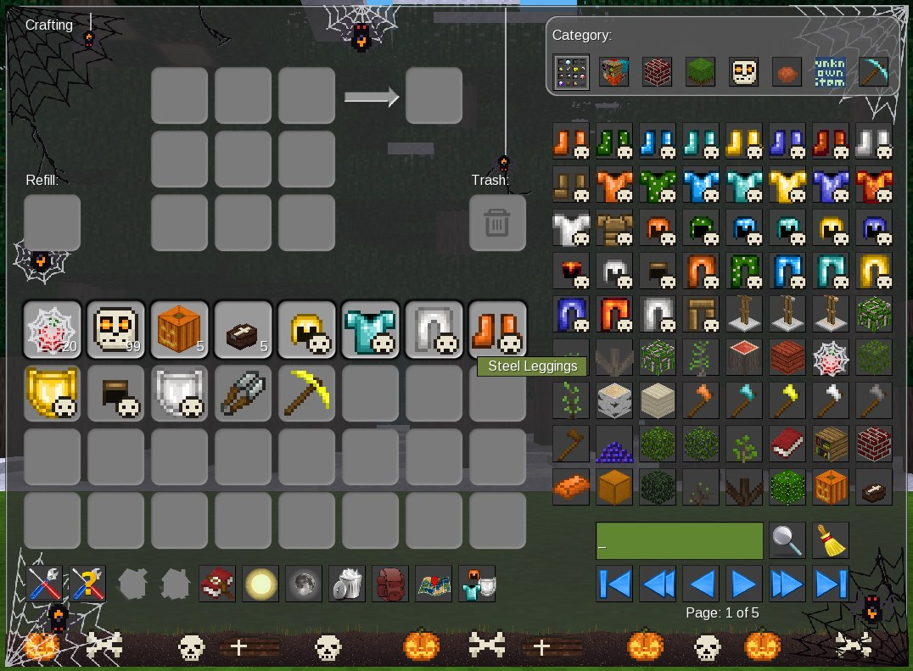
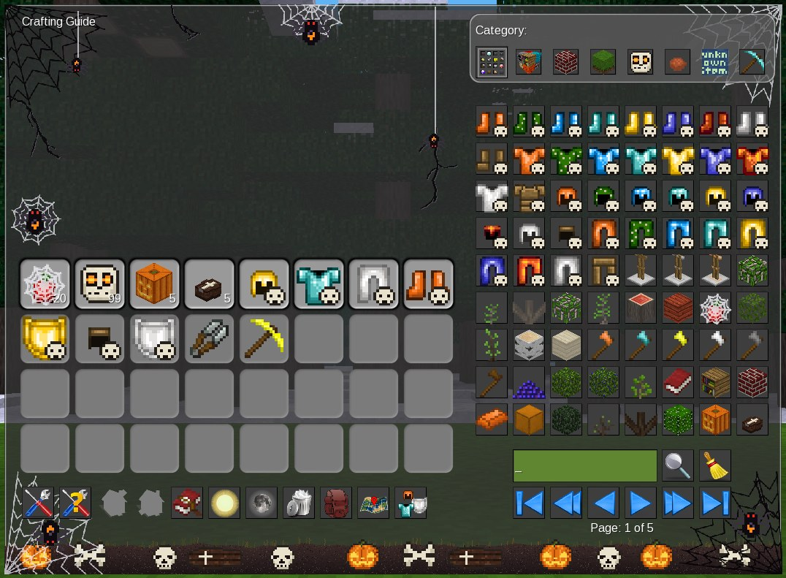
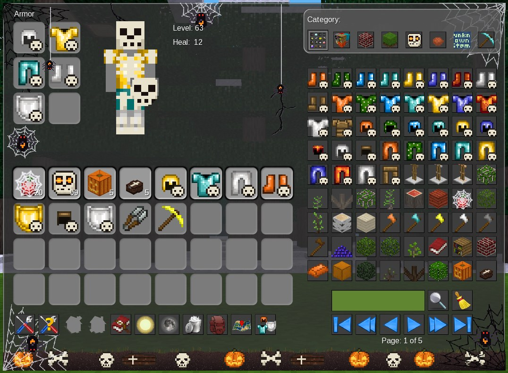
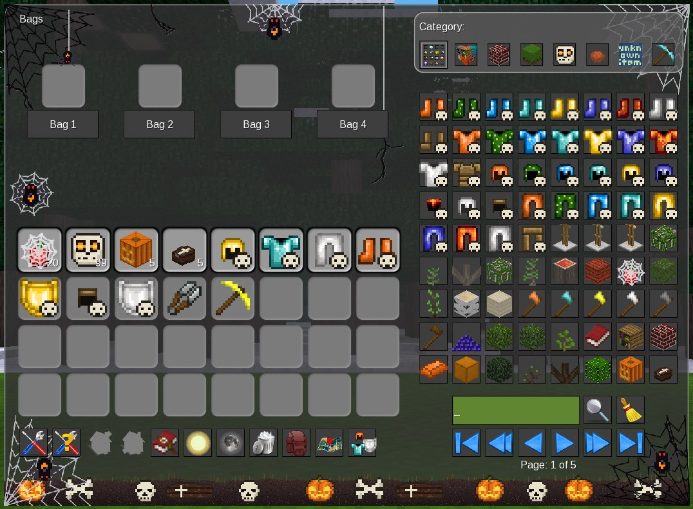
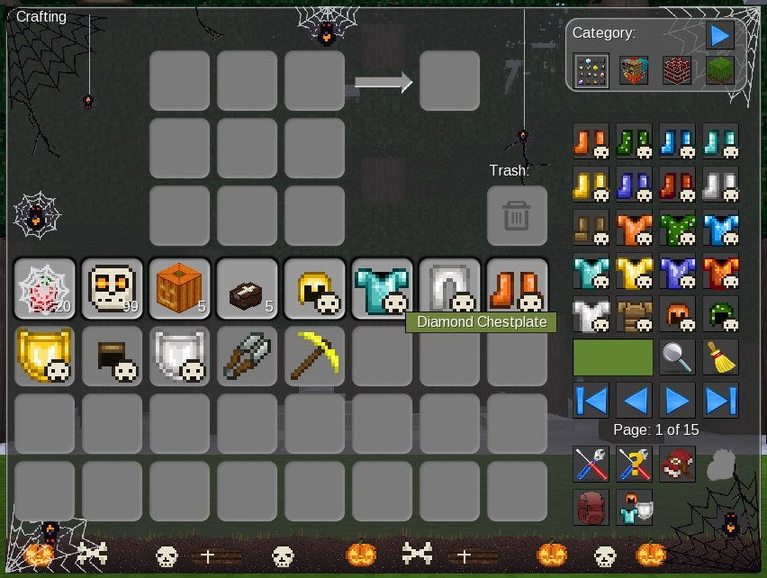

## How it works

- Everything happens in `minetest.register_on_mods_loaded` through `minetest.override_item`, so node
  definitions change only in the server's memory.
- If a mod is missing on a server (for example `connected_chests` or `shields`), that part is skipped.
  All dependencies in `mod.conf` are optional.
- **Protected chest:** `protector:chest` becomes a skull mesh (`halloween_skullchest.obj`). A node cannot
  change its look per position, so the mod registers one helper node, `halloween:protector_chest_open`: a
  copy of `protector:chest` (same formspec, protection, dig rules and drop) with the open-mouth mesh. When
  a player opens the chest it is swapped to the helper with `swap_node` (inventory and meta stay in place),
  and swapped back when the last viewer closes the formspec, leaves the game, dies or walks away, and on
  server shutdown. An LBM (`run_at_every_load`) turns any open skull that is still in the map back into
  `protector:chest`, so an open skull can only stay in the map after a crash, and it is fixed on the next
  start while the mod is installed.
- **Doors:** the picture is overlaid on the front tiles only. For locked doors the mod picks doors and
  trapdoors from `doors.registered_doors` / `doors.registered_trapdoors` with `protected = true`, so locked
  doors from other mods (for example the steel bar door of `xpanes`) are covered too. The pumpkin overlay
  follows the 38x32 layout of the `door_a.b3d`/`door_b.b3d` texture (the lower panel on both faces). The
  protector doors are two nodes (`_b_*` / `_t_*`), each gets its half of the cobweb picture.
- **Sheep:** the texture is changed only on the live object (`set_properties`). The mob's own fields
  (`base_texture` etc.) are left alone, so the Halloween texture never ends up in saved staticdata.
  mobs_animal resets the texture on shearing, dyeing and wool regrowth, so the mod checks it again
  every 0.5 s.
- **unified_inventory:** the mod wraps `unified_inventory.get_formspec`. Right after the standard
  background it inserts its own `background[]` elements, so cracks, cobwebs (black and white, in the
  corners and in the empty areas) and sitting spiders are drawn under the slots, buttons and text.
  The window gets 0.75 taller: a strip of graveyard ground at the bottom with pumpkins, skulls, bones
  and coffins. Two spiders go down and up on their threads (`animated_image[]`) in the free areas
  left of the craft grid and above the trash slot. Both layouts (full and `unified_inventory_lite`) are
  supported. Nothing is stored anywhere, only the formspec sent to the client changes; without
  `unified_inventory` this part is skipped.
- **survival_shelter** runs an older mobs_animal with a different sheep model and a separate model for
  shaved sheep. The mod detects this by the presence of `models/mobs_sheep_shaved.b3d` and uses the
  `halloween_sheep_old*.png` textures.

## Installation

The mod lives in `minetest_game/mods/halloween` on the server.
Mods inside the game load automatically, so there is no need to enable it in `world.mt`. Just
restart the server.

## Removing after Halloween

1. Stop the server normally (on shutdown every open skull is turned back into a protected chest).
2. Delete the `minetest_game/mods/halloween` folder from the server.
3. Start the server.

If the server crashed while somebody was looking into a protected chest, start it once more with the mod
still installed before removing it: the LBM turns that chest back. Otherwise it would show up as an unknown
node `halloween:protector_chest_open` (its contents are kept and come back after reinstalling the mod).

After the restart players see the normal apples, torches, chests, doors, armor, sheep and inventory window again.
If a client still shows the old textures from its cache, reconnecting is enough.

## Files

```
halloween/
├── mod.conf
├── init.lua          — all texture-swap logic
├── textures/         — generated textures (halloween_*.png, halloween_ui_*.png for unified_inventory)
├── models/           — skull meshes for floor, wall and ceiling torches and for the
│                       protected chest, closed and open (.obj)
├── screenshots/      — screenshots for this README (not used by the game)
└── tools/            — texture and model generator (only in the tiny_shelter copy)
    ├── gen_textures.py
    ├── b3d.py        — reader for the sheep .b3d models
    └── masks/        — armor masks for 3d_armor
```

## Regenerating textures

All PNG and OBJ files are produced by `tools/gen_textures.py` (requires Python 3, `numpy`, `Pillow`):

```bash
python3 tools/gen_textures.py
```

Without arguments the script generates everything except the sheep (including the `halloween_ui_*`
textures for the inventory window, the skull chest atlas `halloween_skullchest.png` with its meshes and the
door overlays `halloween_door_*`, `halloween_trapdoor_*` and `halloween_badge_*`). To redraw the sheep, pass three
arguments in the form `<model.b3d>:<tex1.png>,<tex2.png>,...`:

- **NEW**: `mobs_sheep.b3d` + `mobs_sheep_base.png`, `mobs_sheep_wool.png` from the server;
- **OLD**: the same files from survival_shelter (older mobs_animal);
- **OLD_SHAVED**: `mobs_sheep_shaved.b3d` + `mobs_sheep_shaved.png` from survival_shelter.

After regenerating, copy `textures/` and `models/` into the mod copies on the server.
