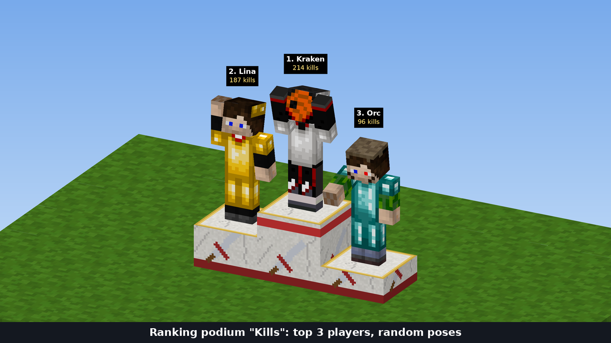
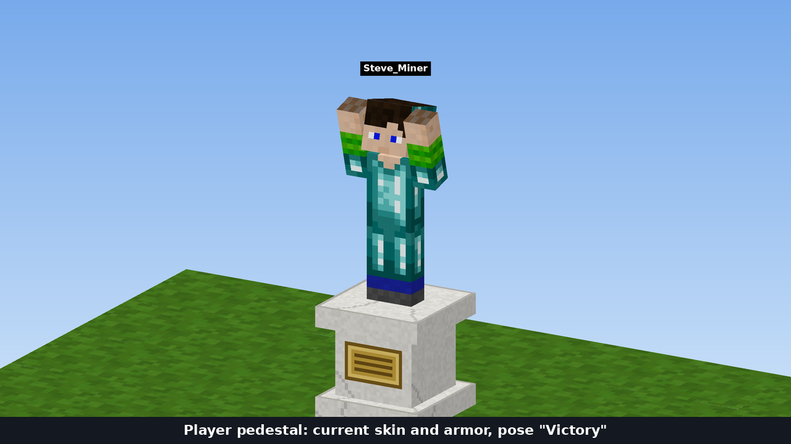
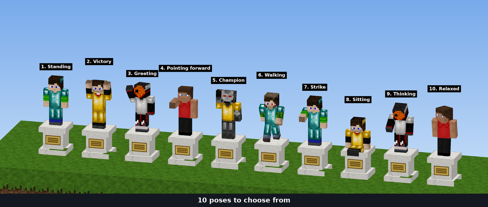
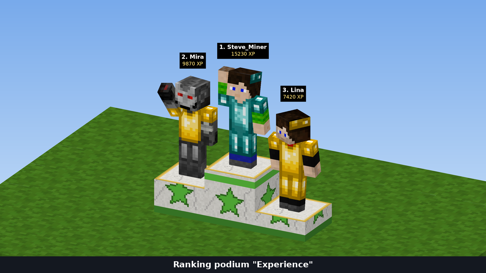
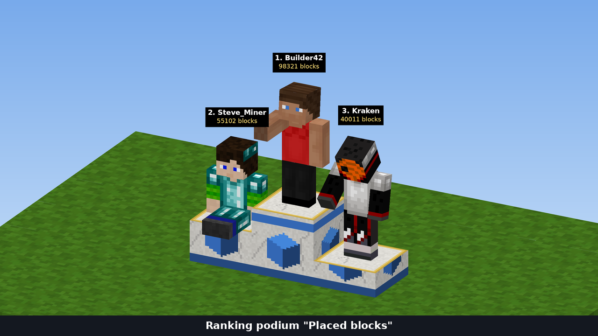

# player_pedestal — pedestals with player statues

A Luanti mod (5.9+, tested on 5.18) for the **tiny SHELTER** and **SHELTER (techage)** servers.



## Features

* **Player pedestal**: an admin writes a player name on the nameplate and a statue of that player appears on the pedestal, wearing the player's skin and current armor. It works for offline players too.
* **Ranking podiums (top 3)**: each podium has three places: 1st in the middle and highest, 2nd on the left, 3rd on the right. Statues update automatically when the ranking changes. There are three podiums:
  * **Experience**: players with the most experience;
  * **Kills**: players with the most kills;
  * **Placed blocks**: players who placed the most blocks.
* **10 poses**. On a player pedestal the pose is chosen in the menu. On podiums the pose is random and re-rolled every time the ranking changes and every time the podium loads.
* **Admin only**. Only players with the `pedestal_admin` (or `server`) privilege can place, configure, dig or rotate pedestals. Nobody else can do anything to them: pedestals are immune to TNT and pistons, nothing can be placed into a podium's space and liquids can't flow into it.

| Player pedestal | 10 poses |
|---|---|
|  |  |

| "Kills" podium | "Experience" podium | "Placed blocks" podium |
|---|---|---|
|  |  |  |

> The screenshots are preview renders made from the mod's real textures, skinsdb skins and 3d_armor armor, using the same geometry and poses as the code. Lighting and anti-aliasing look slightly different in-game.

## Podiums exist only when their statistic exists

A podium is registered only if its data source is present. If the server doesn't have the source, the podium does not exist in the game at all.

| Podium | Node | Source |
|---|---|---|
| Experience | `player_pedestal:podium_xp` | `cb_xp` (Cubeborn), unless experience is turned off (`cubeborn.xp = false`) |
| Kills | `player_pedestal:podium_kills` | `atl_server_statistics`, "Kills Count" |
| Placed blocks | `player_pedestal:podium_placed` | `atl_server_statistics`, "Nodes Placed" |

The player pedestal `player_pedestal:pedestal` is always available.

If a statistic is turned off after its podiums have already been placed (for example experience via `cubeborn.xp = false`), those podiums are **disabled**. They stay in place, darkened, without statues, with the label "This ranking is turned off on the server". New ones can't be placed and they are hidden from the creative inventory. Turn the statistic back on and the podiums work again.

## Installation

1. Copy the `player_pedestal` folder into `luanti_files/games/minetest_game/mods/` or into the world's `worldmods`.
2. If the mod is not inside the game, enable it in `world.mt`: `load_mod_player_pedestal = true`.
3. Restart the server (`docker compose restart`). The log should contain:
   `[player_pedestal] rankings ready: xp, kills, placed`. It lists the podiums that found their statistic.

The only hard dependency is `player_api`. Everything else (`3d_armor`, `skinsdb`, `atl_server_statistics`, `cb_xp`, `default`, `mesecons_mvps`, `screwdriver`) is optional.

## Usage

Get the items: `/giveme player_pedestal:pedestal`, `/giveme player_pedestal:podium_kills`, etc. They are also in the creative inventory.

**Player pedestal.** Place it and it will face you. Right-click to open the menu:
* *Player name (nameplate)*: the player to show. If no player with that name exists in the server database, the pedestal stays empty;
* *Pose*: one of 10;
* *Hide name above the statue*;
* *Rotate*, *Clear* and *Save* buttons.

**Ranking podium.** It needs one free block to the left and to the right of where it is placed: these are the wings for 2nd and 3rd place. Right-click shows the current top 3 and a "Refresh now (new poses)" button. Pointing at the podium shows a tooltip with the top 3.

### Poses

1. Standing
2. Victory (both arms up)
3. Greeting
4. Pointing forward
5. Champion (one arm up)
6. Walking
7. Strike
8. Sitting
9. Thinking
10. Relaxed

Poses are defined in `poses.lua`: a frame of the player model animation plus bone rotations.

## How an offline player's look is stored

The engine can't read the inventory or skin of a player who is offline. So the mod remembers each player's look while they are online: the model, the skin and the armor layer, without the wielded item. This happens on join, on leave and whenever the skin or armor changes. Captures run at most once every 2 seconds per player, and storage is written only if the look actually changed.

If a player hasn't joined since the mod was installed, their statue uses the default skin. It updates automatically the next time they log in.

## Server load

Keeping the server load low was the main requirement. How it's done:

* No `globalstep`, and statues have no `on_step`. A statue is a static entity frozen in a pose, so the server spends nothing on it per step.
* Statues are not saved with the map (`static_save = false`). They disappear when their mapblock unloads and an LBM re-creates them when it loads again. Entities don't pile up in the database.
* Rankings are kept **incrementally**. A full pass over the statistics storage happens once at startup (and on `/pedestal_refresh`). After that every change of a player's counter is compared against a top-10 buffer, which takes a few operations.
* Every `update_interval` seconds (30 by default) the mod checks podiums, but only loaded ones and only if their top 3 changed. If the player in a place changed, only that statue is rebuilt. If only the number changed, only the label is updated.
* Names above statues are visible only within 8 blocks. The engine has no distance limit for nametags, so the name sits on a separate invisible entity. Once a second the mod checks "players × loaded names" distances and changes the viewer list (`set_observers`) only for names whose viewers changed. While no names are loaded the check does nothing.

## Settings (`minetest.conf`)

| Setting | Default | Description |
|---|---|---|
| `player_pedestal.update_interval` | `30` | How often (seconds) podiums check for ranking changes |
| `player_pedestal.rank_exclude` | empty | Comma-separated names never shown on podiums (admins, test accounts) |
| `player_pedestal.nametag_distance` | `8` | The name above a statue is shown only to players closer than this (blocks). The statue itself is visible to everyone |
| `player_pedestal.show_values` | `true` | Show the value (experience/kills/blocks) under the name on podiums |
| `player_pedestal.invert_pitch` | `false` | Flip the arm and head pitch in poses, if raised arms point backwards on your model |

## Privilege and commands

The `pedestal_admin` privilege allows creating and managing statues. Players with `server` have the same rights. Grant it with `/grant <name> pedestal_admin`.

* `/pedestal_refresh` — rescan rankings and re-create all loaded statues (with new random poses).
* `/pedestal_bone <bone> <x> <y> <z>` — rotate a bone of the nearest statue within 6 blocks to tune a pose. Bones: `Head`, `Body`, `Arm_Left`, `Arm_Right`, `Leg_Left`, `Leg_Right`. Put the values you like into `poses.lua`.

## Adding your own ranking

Podiums are created at load time for every source found. A new source is added in `ranking.lua`, following the `cb_xp` block:

```lua
R.register_source("mystat", {
	label = S("My stat"), unit = S("points"),
	scan = function() return { Player1 = 10, Player2 = 5 } end, -- full pass, once at startup
})
-- on every change of a player's value:
R.update("mystat", name, new_value)
```

You also need a texture `textures/player_pedestal_podium_mystat.png`.

## Layout

```
player_pedestal/
├── mod.conf, settingtypes.txt, init.lua
├── poses.lua        poses
├── appearance.lua   player look cache (skin + armor)
├── ranking.lua      statistic sources and the incremental top list
├── statue.lua       statue entity, placement, podium updates
├── nodes.lua        pedestal, podiums, menus, LBM
├── commands.lua     admin commands
├── locale/          Russian translation
├── textures/
└── screenshot.png, screenshots/
```
