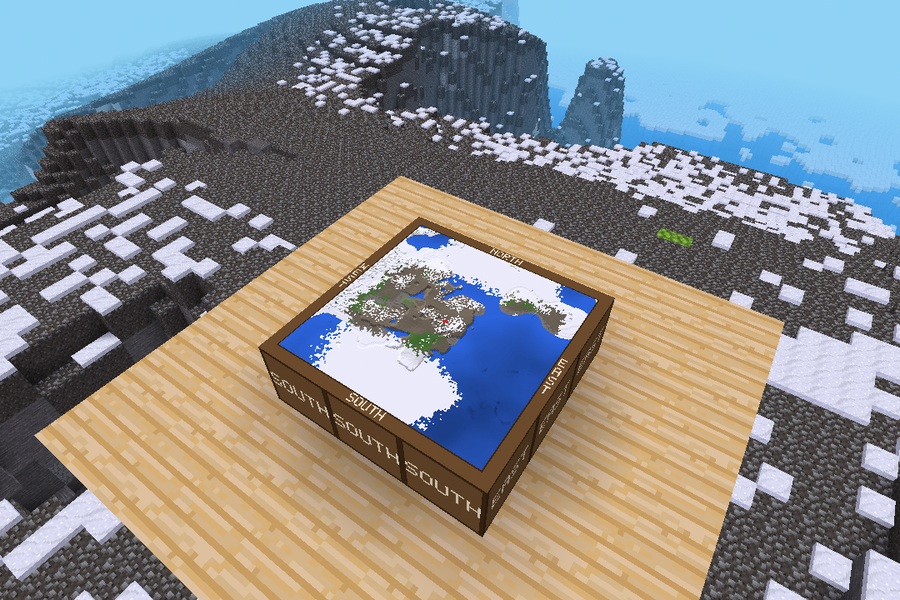

# spawnmap

Once a day the mod takes a top-down snapshot of the world within
`spawnmap_radius` (default 2000) blocks of spawn and shows it on 9 blocks.
Put them together as a 3x3 square to get the map.

* The blocks are `spawnmap:map_nw`, `map_n`, `map_ne`, `map_w`, `map_c`,
  `map_e`, `map_sw`, `map_s`, `map_se`. You get them from the creative
  inventory (search for "Spawn Map") or with `/spawnmap_kit` (`give` priv).
* The map is always oriented to the world: north is +Z. Place `map_nw` at
  the north-west corner. The frame on top and the outer sides of the blocks
  are labelled NORTH / SOUTH / EAST / WEST.
* Only Y from `spawnmap_ymin` to `spawnmap_ymax` (-64..256) is scanned,
  so floatlands, sky islands and cloud blocks are never captured. When the
  v7 floatlands are on, the upper limit is lowered below them automatically.
  Node names matching `spawnmap_ignore_nodes` (default `cloud`) count as air.
* Areas nobody has visited yet are not generated, they show as a dark
  checkerboard.
* The blocks glow like a lamp (light 14, change with `spawnmap_light`).
* The red cross marks spawn (`static_spawnpoint`, or 0,0).

## Files in the world folder

Only the archive: `<world>/spawnmap_archive/spawnmap_<date>_<time>_<N>.png`,
every snapshot as one full map image. Keep all of them
(`spawnmap_archive_max = 0`) or only the last N.

The textures currently shown on the blocks are kept in the mod storage
and sent to players from memory, no extra files are written.

## Commands

* `/spawnmap_update` (`server` priv): take a snapshot now.
* `/spawnmap_status`: progress, or time until the next snapshot.
* `/spawnmap_kit` (`give` priv): give yourself all 9 blocks.

## Settings

See `settingtypes.txt`. Main ones: `spawnmap_radius`, `spawnmap_interval`
(seconds, 86400 = once a day), `spawnmap_tile_size` (pixels per block),
`spawnmap_budget_ms` (server time per step for scanning).

The scan is spread over many server steps (15 ms each by default), so it
never freezes the server. Each 16x16 mapblock column is read only once.

Detail vs. time (`spawnmap_tile_size`, measured on a fully generated
area of radius 800; radius 2000 takes about 6x longer):

| tile size | whole map | one pixel at radius 2000 | radius 800 scan |
|-----------|-----------|--------------------------|-----------------|
| 64        | 192 px    | ~23 blocks               | 150 s           |
| 128 (default) | 384 px | ~11 blocks              | 194 s           |
| 256       | 768 px    | ~5 blocks                | 265 s           |
It only reads the map that already exists and never generates new terrain.

Requires Luanti 5.9+ (uses `dynamic_add_media` with `filedata`, `encode_png` and `[png:`).
