# The Tiny Spawn — solarpunk/неон спавн для tiny SHELTER

Мод **один раз** строит спавн в стиле «solarpunk + неон-фэнтези»: квадрат ±60 блоков от указанной точки,
в центре — широкий полупрозрачный луч света в небо (не наносит урона, сквозь него можно ходить).

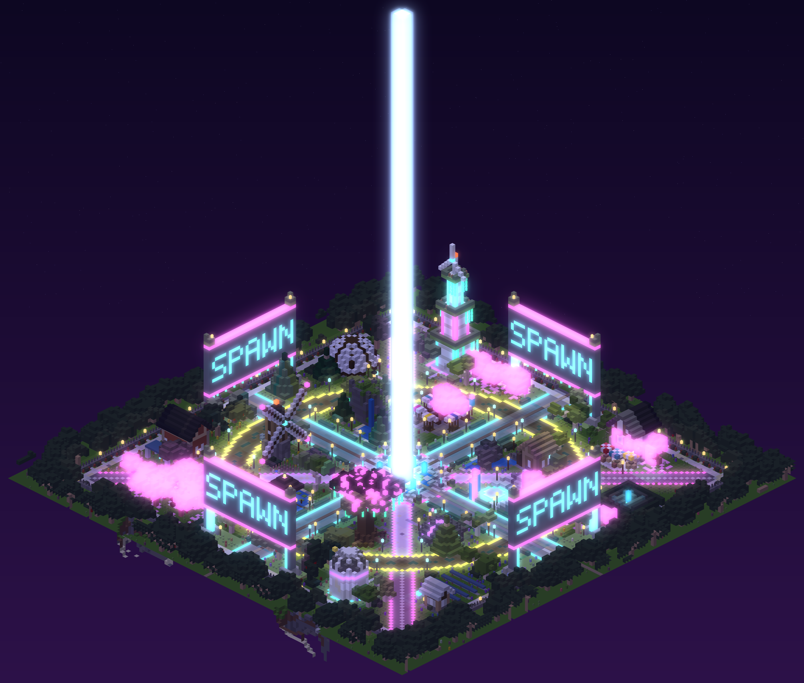

Крупный план: [screenshots/preview_close.png](screenshots/preview_close.png),
вид сверху: [screenshots/preview_top.png](screenshots/preview_top.png).
Превью отрисованы из настоящей карты после генерации на тестовом сервере (`tools/render_preview.py`).

## Скриншоты геймплея

Сняты в настоящем клиенте Luanti 5.18, подключённом к тестовому серверу (`screenshots/gameplay/`):

| | |
|---|---|
| 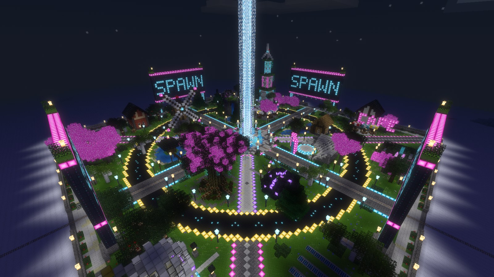 Обзор спавна ночью | 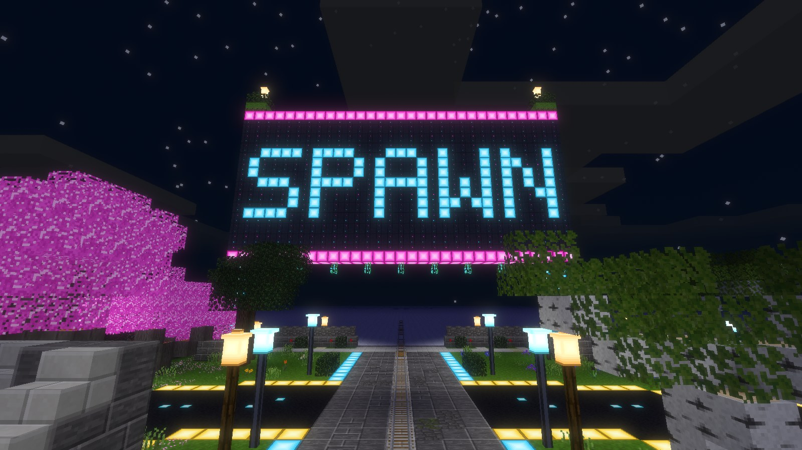 Ворота SPAWN над железной дорогой |
| 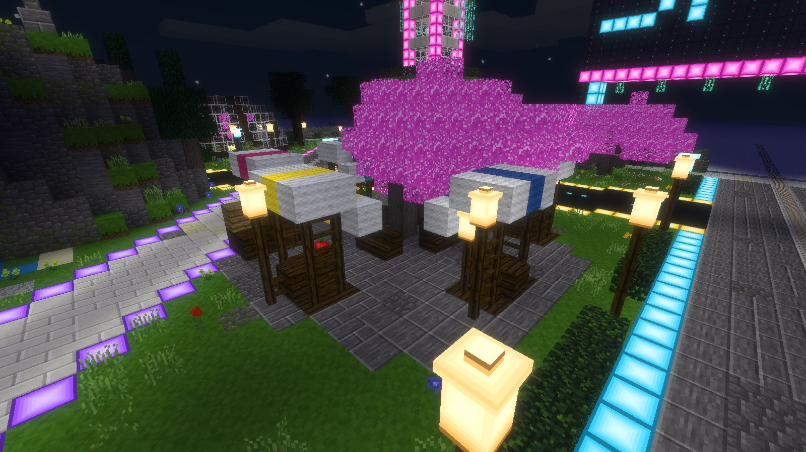 Ночной базар | 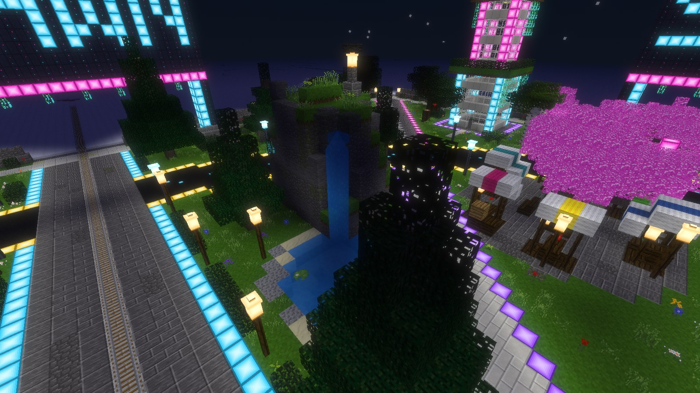 Водопад и пруд |
| 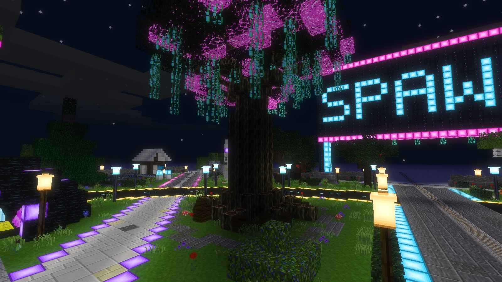 Древо Света | 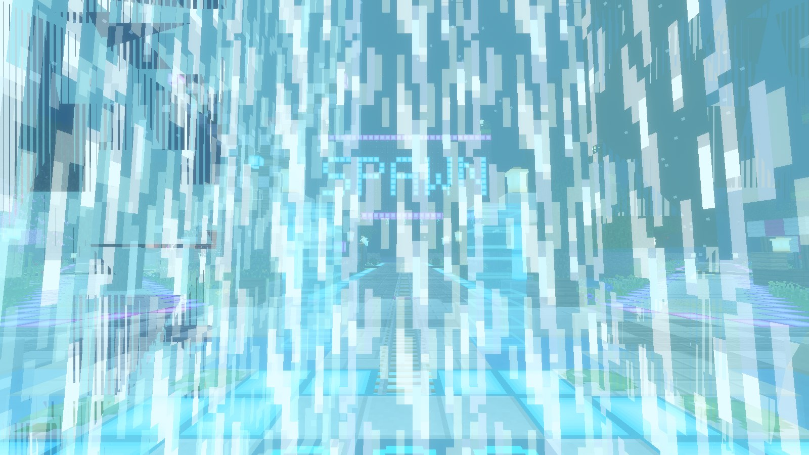 Появление игрока внутри луча |
| 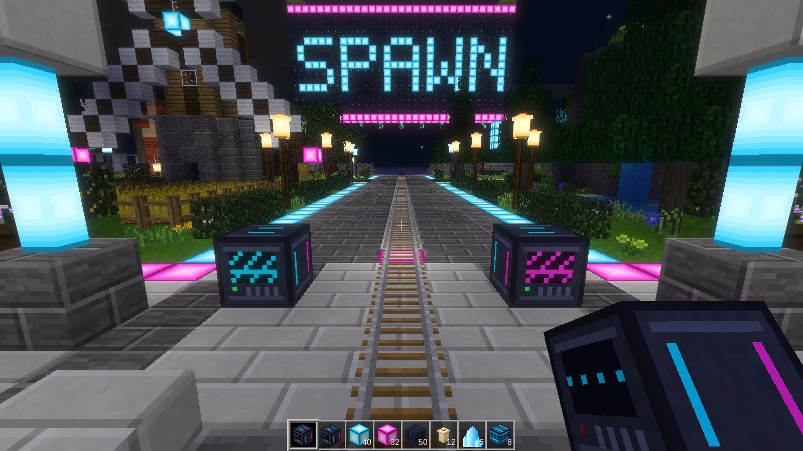 Кибер-машины в работе | 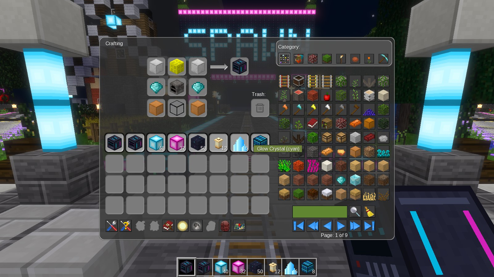 Крафт Кибер-фабрикатора |
| 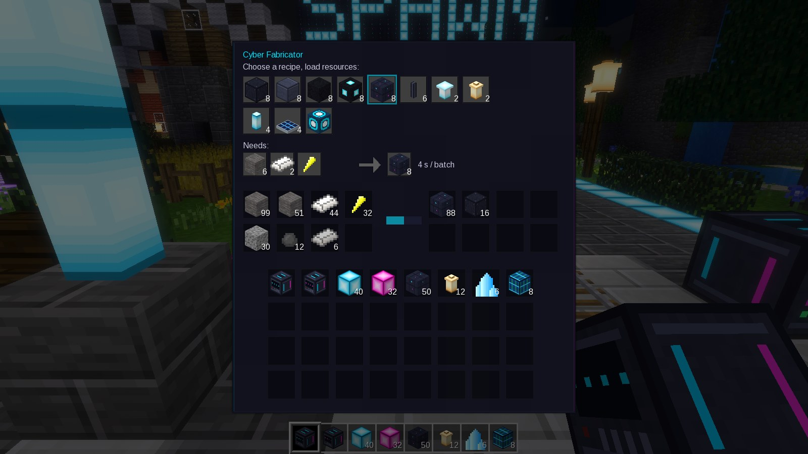 Фабрикатор делает панели | 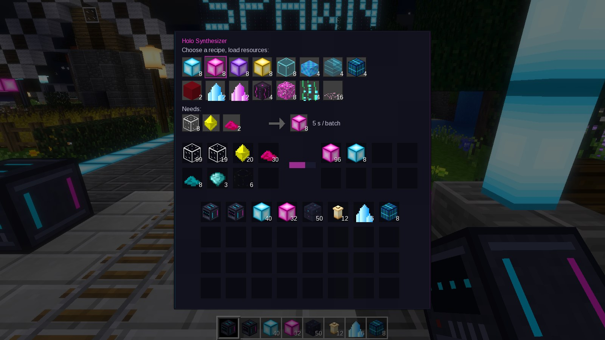 Синтезатор делает неон |

## Кибер-машины: блоки спавна для всех игроков

Уникальные блоки спавна могут делать и игроки, но только в двух машинах из ценных ресурсов.

**Как пользоваться:** поставить машину, открыть её (ПКМ), нажать на нужный рецепт на экране и положить
ресурсы во входные слоты (слева). Машина сама делает партию за партией, пока хватает ресурсов
и есть место в выходных слотах (справа). Экран машины светится и анимируется во время работы.
Чужую машину в защищённой зоне открыть и обобрать нельзя. Сломать машину можно только пустой.

**Крафт машин** (на верстаке, намеренно дорогой):

```
Кибер-фабрикатор               Голо-синтезатор
[стал.блок] [мезе-блок] [стал.блок]   [зол.блок]  [обсид.стекло] [зол.блок]
[алмаз]     [печь]      [алмаз]       [мезе-блок] [алмаз.блок]   [мезе-блок]
[мед.блок]  [обсид.стекло] [мед.блок] [олов.блок] [стал.блок]    [олов.блок]
```

**Кибер-фабрикатор** (конструкционные блоки):

| Результат | Ресурсы | Время |
|---|---|---|
| 8 кибер-плит | 8 камня + стальной слиток | 3 с |
| 8 светлых плит | 8 камня + оловянный слиток | 3 с |
| 8 кибер-асфальта | 6 гравия + 2 угля | 3 с |
| 8 асфальта с неоновой линией | 6 гравия + 2 угля + 2 осколка мезе | 4 с |
| 8 стеновых панелей | 6 камня + 2 стали + осколок мезе | 4 с |
| 6 опор фонаря | 3 стали | 3 с |
| 2 кибер-фонаря | 2 стекла + кристалл мезе | 5 с |
| 2 солнечных фонаря | 2 стекла + золото + 3 осколка мезе | 5 с |
| 4 неоновые колонны | 2 стекла + кристалл мезе + голубой краситель | 5 с |
| 4 солнечные панели | 2 стекла + 2 олова + медь + кристалл мезе | 6 с |
| 1 излучатель луча | 2 алмаза + 2 золота + блок мезе | 10 с |

**Голо-синтезатор** (неон, голограммы, растения):

| Результат | Ресурсы | Время |
|---|---|---|
| 8 неона (голубой / пурпурный / фиолетовый / жёлтый) | 8 стекла + кристалл мезе + 2 красителя | 5 с |
| 8 неонового стекла | 8 стекла + 2 осколка мезе + голубой краситель | 4 с |
| 4 голо-бассейна | 4 стекла + кристалл мезе + синий краситель | 5 с |
| 4 голо-колонны | 2 обсид. стекла + кристалл мезе + голубой краситель | 6 с |
| 4 голо-экрана | 2 обсид. стекла + 2 кристалла мезе + медь | 6 с |
| 2 маяка | стекло + кристалл мезе + 2 красных красителя | 5 с |
| 2 светящихся кристалла (голубой / пурпурный) | алмаз + 4 осколка мезе + краситель | 8 с |
| 4 неоновых ствола | 4 бревна + 2 осколка мезе + пурпурный краситель | 4 с |
| 8 неоновой листвы | 8 листвы + 2 осколка мезе + розовый краситель | 4 с |
| 4 светящиеся лианы | 4 листвы + 2 осколка мезе + зелёный краситель | 4 с |
| 16 лепестков сакуры | бумага + 2 розовых красителя | 3 с |

Луч (`beam_core` / `beam_halo`) не крафтится: он остаётся уникальным для спавна.
Если стоит `unified_inventory`, все рецепты машин видны в его книге крафта.

## Дизайн: что взято из референсов

Принципы лучших спавнов (референс *Circular Spawn Hub Concept* и гайды по детализации):

1. **Иерархия фокусов:** луч и фонтан в центре, четверо ворот, у каждого квартала свой ориентир.
2. **Симметричен только каркас дорог**, кварталы разные, поэтому спавн выглядит построенным вручную.
3. **Рельеф и вода:** холм со скалами и водопадом, пруды, ручей, каменные выходы.
4. **Глубина:** многослойные стены, цоколи, карнизы из ступеней и плит, двускатные крыши со свесом.
5. **Фактура:** полы и скалы из смеси блоков, собранных пятнами (кластерный градиент).
6. **Живая зелень:** органичные деревья (сакура, яблони, сосны, осины), кусты, живые изгороди,
   цветы «пятнами», трава, кувшинки, тростник, светящиеся лианы.
7. **Свет:** тёплые солнечные фонари и неоновые акценты.
8. **Микродекор** в ключевых местах: лавки, навесы, ящики, скамейки, столики, зонтики.

## Что строится

**Каркас (симметричный, как на старом спавне):** 4 прямые улицы по осям С/Ю/З/В под железные дороги,
кольцевая дорога с жёлтой неоновой каймой, диагональные дорожки внутри кольца и дороги к углам,
тротуар и низкая стена с фонарями по периметру. Центр: луч, водное кольцо с 8 мостиками,
голо-фонтаны, кувшинки, неоновые кольца, фонарные колонны, скамейки.
Ворота с большой неоновой надписью «SPAWN» и озеленёнными пилонами (проём 27×8 — поезда проходят).

**8 уникальных кварталов** (внутри кольца / за кольцом):

| Сторона | Внутри кольца | За кольцом |
|---|---|---|
| ВСВ | Ночной базар: 6 лавок с полосатыми навесами, сакура со скамейкой | Зелёный шпиль: башня с садами-террасами и ветротурбиной |
| ВЮВ | Мельничный ручей: водяное колесо, каменный мостик | Неоновое кафе: терраса, зонтики, вывеска CAFE |
| ССЗ | Солнечный ветряк и поля пшеницы/хлопка | Мастерская-амбар и навес из солнечных панелей |
| ССВ | Холм со скалами, водопадом и прудом | Оранжерея-купол с джунглями внутри |
| ЗЮЗ | Древо Света: гигантское дерево с лианами и фонарями | Обсерватория с телескопом |
| ЗСЗ | Пруд с лотосами и пагодой на острове | Роща сакуры с каменным фонарём |
| ЮЮВ | Голо-амфитеатр | Лабиринт из живой изгороди с кристаллами |
| ЮЮЗ | Сад кристаллов и жеода | Солнечная ферма с аккумуляторами |

Спавн стоит **на земле**: под полом сплошной фундамент, пустоты, вода и деревья под ним засыпаются до грунта.

## Железные дороги

Ни один рельс не перестраивается и не удаляется. Перед стройкой мод находит все рельсовые ноды в зоне:
`carts` (группа `rail`, drawtype `raillike`), `advtrains` (группы `advtrains_track` и `save_in_at_nodedb`:
рельсы, стрелки, сигналы), префиксы `advtrains*`, `carts:`, `linetrack`, `ks:`, `subways`.
Они остаются на месте с тем же `param2`. Вокруг каждого рельса очищается коридор (±1 блок в стороны, 4 вверх),
под висящим рельсом подкладывается опора. В БД advtrains ничего не ломается, потому что эти ноды не трогаются.

Улицы по осям шириной 7 блоков: центральная полоса — светлое «ложе» под рельсы.
Если рельсы на проде смещены от оси на 1–3 блока, они всё равно окажутся на улице.

## Установка

1. Скопировать папку `the_tiny_spawn` в `luanti_files/games/minetest_game/mods/`
   (или в `worldmods/` мира). Зависимости: `default`, `stairs`, `flowers`, `wool`, `dye` (всё из minetest_game); опционально `areas`, `walls`, `farming`, `unified_inventory`.
2. Перезапустить сервер: `docker compose restart luanti`.

## Команды (нужна привилегия `server`)

| Команда | Что делает |
|---|---|
| `/tiny_spawn_scan 0 4 0` | Ничего не меняет: показывает найденные рельсы, их высоты и направления |
| `/tiny_spawn_generate 0 4 0` | Строит спавн (один раз). `x y z` — точка, где стоят игроки (как `static_spawnpoint`) |
| `/tiny_spawn_generate here` | То же самое от текущей позиции игрока |
| `/tiny_spawn_generate 0 4 0 60 force` | Пересобрать ещё раз (радиус 40–120, по умолчанию 60) |
| `/tiny_spawn_undo` | Вернуть территорию как было (из резервной копии) |
| `/tiny_spawn_status` | Показать, был ли спавн уже построен |

Пол спавна ставится на `y-1`, то есть игрок в указанной точке стоит на излучателе прямо в луче.
На tiny SHELTER `static_spawnpoint = 0,4,0`, значит команда — `/tiny_spawn_generate 0 4 0`.

**Перед генерацией на проде** выполните `/tiny_spawn_scan 0 4 0`. Рельсы, стоящие на полу, должны показать
высоту `h+1`. Если высота другая, сдвиньте `y` в команде так, чтобы рельсы легли на пол.

## Безопасность

* Флаг «уже построено» хранится в mod storage, поэтому повторный запуск без `force` отклоняется.
* Перед стройкой создаётся бэкап в `<world>/the_tiny_spawn_backup/`: схематики зоны и луча плюс метаданные
  (сундуки с содержимым, таблички). `/tiny_spawn_undo` восстанавливает всё (проверено на тесте).
  При `force` сохраняется самый первый бэкап, то есть исходный мир.
* Если стоит мод `areas`, зона защищается регионом «Tiny Spawn» на имя администратора (при undo регион удаляется).
* Используются только блоки minetest_game (`default`, `stairs`, `flowers`, `wool`, опционально `walls`, `farming`)
  и собственные блоки мода.
* Внутри квадрата всё выше пола очищается: постройки игроков в радиусе 60 будут снесены (их вернёт undo).
* Перед запуском на проде всё равно сделайте бэкап `map.sqlite`.

## Настройки (`minetest.conf`)

```
the_tiny_spawn_beam_height = 160   # высота луча
the_tiny_spawn_radius = 60         # радиус по умолчанию
the_tiny_spawn_protect = true      # регион areas
the_tiny_spawn_backup = true       # бэкап для undo
```

## Файлы

* `machines.lua` — Кибер-фабрикатор и Голо-синтезатор: рецепты, интерфейс, таймер, крафт машин.
* `nodes.lua` — блоки: неон, панели, асфальт, луч, голограммы, солнечные фонари и панели, лианы, кристаллы.
* `layout.lua` — симметричный каркас: план дорог, площадь, ворота, стена, изгороди, досадка зелени.
* `districts.lua` — 8 уникальных кварталов.
* `lib.lua` — строительные приёмы: ступени с ориентацией, холмы, пруды, деревья, дома, купола, текст.
* `generator.lua` — emerge, бэкап, VoxelManip-стройка, защита рельсов, undo.
* `tools/gen_textures.py` — генерирует все текстуры (`python3 tools/gen_textures.py`).
* `tools/render_preview.py` — рендер превью из `map.sqlite` (+ `nodeinfo.json` с текстурами блоков).
